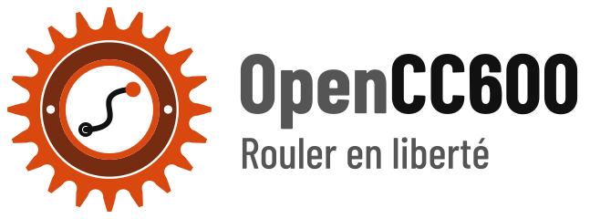

<p align="center">
  <picture>
    <source media="(prefers-color-scheme: dark)" srcset="docs/logo-wide-night.svg">
    
  </picture>
</p>

# opencc600

Open firmware for the **GEOID CC600** bike computer (ESP32-S3; a Magene C606 board without eMMC and without touch).

Our Rust image boots from `ota_0` (the vendor firmware stays in `ota_1`, one command brings it back) and is
ridden. Written in **Rust (`no_std`, esp-hal + Embassy)**; the hardware layer is a rewrite based on
[c606-oss](https://github.com/HighwayStar/c606-oss) (GPL-3.0). The companion app is
[Musette](https://github.com/enavarro222/musette).

> **Use at your own risk.** This is an unofficial hobby project, not affiliated with or endorsed by GEOID or
> Magene. Flashing it may void your warranty and could leave your device unusable; rides may be lost and figures
> may be wrong. Keep the backups `tools/flash_ota0.py` makes. The software comes with no warranty (GPL-3.0,
> sections 15–16): the authors are not liable for any damage to your device, your data or anything else.

## Features
The screens below are the firmware's own drawing code, rendered on a PC by `cargo test -p ui --test screens`
(synthetic rides and routes; the UI is in French for now). Clickable mock-up of the whole UI:
**https://enavarro222.github.io/opencc600/prototype/**

### Ride pages picked for the ride
No page editor: the device picks the pages from what it sees at the start (route loaded, power meter paired,
"explore" or "train"). Large anti-aliased figures (Barlow Condensed), a layout that never moves during a ride,
distances under 1 km in metres, auto-scroll, a night theme.

| Essential | Altitude | Effort (power meter) | Night |
|:-:|:-:|:-:|:-:|
|  |  |  |  |

- **Barometric altitude and D+**: the barometer's bias calibrated on the GNSS with a Kalman filter, D+ from the
  pressure only (pressure spikes rejected), gradient over the last 40 m, climbing speed, the last 5 km profile
  ([docs/ALTITUDE.md](docs/ALTITUDE.md)).
- **Effort**: 3 s power, ride averages, heart rate, cadence.

### Route, map and climbs
A GPX route sent from Musette over BLE (or over USB), the climbs found by the app when it builds the route.

| Map, around the rider | Whole route | Off route | Climbs | In a climb |
|:-:|:-:|:-:|:-:|:-:|
|  |  |  |  |  |

- **Map page** turned to the heading, the part done in grey, zooms 250 m to the whole route, remaining distance;
  drawn in 28–47 ms on the device.
- **Off-route alert** beyond 50 m, with the distance to the route.
- **Climbs**: the last one done, the next ones with their distance; in a climb, distance, D+ and time left to the
  top, its profile coloured by gradient with the rider on it.
- **Free ride**: set the route aside from the menu, even mid-ride, without deleting it.

### Sensors
| Sensors | Search | Power meter calibration |
|:-:|:-:|:-:|
|  |  |  |

- **BLE** heart rate, speed / cadence and power, searched and paired from the device.
- **ANT+** through the nRF co-processor (written, tested on the PC; still to try with a real sensor).
- Power meter zero offset calibration. A sensor lost mid-ride keeps its place with "--" and a banner.

### Recording you can trust
| Home | Pause menu | Ride saved | Rides on the device |
|:-:|:-:|:-:|:-:|
|  |  |  |  |

- **FIT files that survive a power cut**: appended every 10 s, an interrupted ride closed and offered again at the
  next power-on; tested by cutting the power at every flash operation of a ride (PC) and by random resets on the
  device. Files checked with the Garmin FIT SDK.
- A ride paused at power-off, or the last finished one, can be resumed; a ride started by mistake is erased.
- **Automatic power off** after a while without moving, announced a minute before, the ride kept to resume.
- Storage full handled: rides first, logs give way, a point every 5 s when nearly full.
- **GPS time written back to the RTC**, time zone as a POSIX rule with summer time.
- Charging screen, battery and storage status always in the top bar.

### Companion app (Musette, over BLE)
Settings, routes (with their climbs) sent to the device, rides listed, downloaded and acknowledged. The file
formats and the protocol are shared crates in the MIT [musette](https://github.com/enavarro222/musette)
repository.

## Roadmap
MVP status in [docs/PRODUCT.md](docs/PRODUCT.md#mvp).

Next:
- **Battery life** ([docs/POWER.md](docs/POWER.md)): battery-run log, reference run against the vendor firmware,
  automatic backlight from the ambient light sensor, CPU sleep, GNSS settings.
- **Faster GPS fix**: hot start with the last position and the RTC time sent to the receiver; later A-GNSS data.
- **Beeps** for the other alerts (off route, sensor lost, low battery) and key feedback; ride start, pause and stop
  already beep.
- **Key lock** on both bottom keys.
- **Faster ride sync** with Musette (larger reads, shorter connection interval); delete the rides already sent
  first when space runs out.
- **Gradient** that follows the road closer; distance kept during GNSS losses (wheel sensor, straight line).
- **ANT+** tried with real sensors; the wheel sensor's speed in the odometer.

Later:
- **OSM background map** in a corridor around the route, with contour lines (prototype done: 100–400 KB for
  100 km, drawn in 47–107 ms), and the dashed line back to the route when off it.
- **Wi-Fi**: rides uploaded to a configurable URL, route and map downloaded by the device.
- **Web tool** (WebAssembly + Web Serial) to send routes and settings from a browser.
- Auto-pause, start reminder ("you are riding, start?"), a new route received mid-ride.
- Turn announcements, laps; Strava segments maybe.

Deliberately out of scope: global maps and on-device routing.

## Docs
- [docs/PRODUCT.md](docs/PRODUCT.md): principles, hardware constraints, UI rules, ride pages, features, MVP status,
  open questions.
- [docs/ALTITUDE.md](docs/ALTITUDE.md): barometric altitude and D+, the Kalman filter on the GNSS, the vendor's D+.
- [docs/POWER.md](docs/POWER.md): battery life target, consumers, how we measure without opening the case, levers.
- [docs/DEV_PROCESS.md](docs/DEV_PROCESS.md): development and test process (PC, device over USB, field), flash and
  rollback.
- [docs/REVERSE_NOTES.md](docs/REVERSE_NOTES.md): reverse engineering notes (hardware, eFuses, partitions,
  pinout read over JTAG, first run of c606-oss).
- [docs/NRF_FIRMWARE.md](docs/NRF_FIRMWARE.md): the nRF co-processor's firmware (image, ANT, barometer filter).
- [docs/pins_live.txt](docs/pins_live.txt): raw output of `tools/reverse/read_pins.py` on the vendor firmware.

## Firmware
[firmware/](firmware/) is a standalone Cargo project for the Xtensa target (`esp` toolchain from `espup`).
The hardware-independent `no_std` crates live in the host workspace at the root, on the stable toolchain, and are
tested on a PC with `cargo test`:
- [crates/nrf-link/](crates/nrf-link/): UART protocol with the nRF co-processor (frames, CRC, keys, battery, RTC,
  barometer, light, buzzer, commands).
- [crates/gnss/](crates/gnss/): NMEA reader (checksums, error counters) and fix parser for the Airoha AG3352Q,
  `$PAIR` commands; tested on an anonymised capture.
- [crates/ride-store/](crates/ride-store/): ride files on littlefs that survive a power cut; its test cuts the power
  at every flash operation of a recording scenario (RAM fake NOR flash).
- [crates/fit/](crates/fit/): FIT activity writer; every file of its tests is decoded again with `fitparser`.
- [crates/recorder/](crates/recorder/): ride recording as FIT on ride-store, pauses, totals, closing of interrupted
  rides; its test cuts the power at every flash operation of a ride and of the recovery.
- [crates/altitude/](crates/altitude/): barometric altitude whose bias is calibrated on the GNSS (Kalman filter),
  tested on synthetic rides; see [docs/ALTITUDE.md](docs/ALTITUDE.md).
- [crates/sensors/](crates/sensors/): BLE GATT measurements and ANT+ pages of the cycling sensors decoded, the ANT+
  channels kept open, rates from cumulative revolution counts, the power meter's calibration.
- [crates/companion/](crates/companion/): the BLE link with Musette (settings, routes, rides listed, read and
  acknowledged), in the frames of `protocol-cc600`.
- [crates/ui/](crates/ui/): screens, what the 3 keys do on each, drawing on the 240x320 panel (embedded-graphics)
  with the prototype's font, Barlow Condensed, anti-aliased (4-bit alpha, generated by `tools/build_fonts.py`); its
  test draws every screen to `target/tmp/screens/*.png` and stops on a missing glyph or a text out of the screen.

The file formats and the protocol shared with the app live in the MIT
[musette](https://github.com/enavarro222/musette) repository and come by git at a pinned `rev` (`Cargo.toml`):
`protocol-cc600` (BLE protocol, resumable file transfer), `route-cc600` (route `OCRT` with its climbs, corridor
map `OCMP`), `settings-cc600` (the settings file, POSIX time zones). To work on them, a `[patch]` towards a local
clone in an untracked `.cargo/config.toml`; bump the `rev` once the musette commit is pushed.

Hardware-in-the-loop tests on a CC600 plugged in over USB (keys injected over USB, storage read back):
`uv run --project tests/hil pytest tests/hil`, see [tests/hil/](tests/hil/) and docs/DEV_PROCESS.md.

`littlefs2` generates its C bindings with bindgen, which needs the clang C headers on the PC
(`sudo apt install libclang-common-18-dev` on Ubuntu 24.04, or the esp toolchain's clang:
`BINDGEN_EXTRA_CLANG_ARGS="--target=x86_64-unknown-linux-gnu -isystem $LIBCLANG_PATH/clang/21/include"`, with
`LIBCLANG_PATH` from `~/export-esp.sh`; never set while building the firmware).

```sh
cargo install espup espflash --locked && espup install --targets esp32s3 && uv tool install esptool
. ~/export-esp.sh
cd firmware && cargo build --release
espflash save-image --chip esp32s3 --flash-size 16mb target/xtensa-esp32s3-none-elf/release/opencc600 ../dump/opencc600.bin
../tools/flash_ota0.py ../dump/opencc600.bin     # ota_0 only; --restore-vendor boots ota_1 again
../tools/serial_log.py 30                         # logs over the USB serial, host-timestamped
```

## UI prototype
Clickable mock-up of the firmware UI (240x320 screen, 3 keys), in French:
**https://enavarro222.github.io/opencc600/prototype/**

The README's screenshots in [docs/screens/](docs/screens/) are copied from `target/tmp/screens/`.

Source: [docs/prototype/prototype.dc.html](docs/prototype/prototype.dc.html); the page
[docs/prototype/index.html](docs/prototype/index.html) is generated by `python3 tools/build_prototype.py`.

## Tools
Day to day:
- `tools/flash_ota0.py`: writes an app image to `ota_0` and erases `otadata`, after checking the device has the
  known CC600 partition layout; saves the original otadata once (`dump/otadata.orig.bin`), `--restore-vendor`
  writes it back (`--storage dump/storage.orig.bin` also puts the vendor storage partition back), `--erase-storage`
  blanks the storage partition for our firmware to format (only with the vendor backup present). Refuses any other
  offset.
- `tools/serial_log.py`: prints the USB serial log for N seconds, each line with the host time (no reset);
  `--send T:TEXT` types a test command at T seconds (`key 2 click`, `sound off`, `gnss cold`, `gnss time on`,
  `rtc shift -300`, `screen ?`, `set tz UTC0`, `get sound`, `settings ?`, `bench map`, `fix LAT_E7 LON_E7
  [MM_S [CDEG]]`, `fix off`).
- `crates/route-tool`: `cargo run -p route-tool -- build IN.gpx OUT [TOL_M]` makes a route file, `info FILE`
  describes one, `sim IN.gpx OUT_DIR [EVERY_S]` rides a GPX through the real UI and writes the screens as PNG.
- `tools/check_fit.py`: decodes FIT files with the official Garmin FIT SDK.

Tests on the device (Musette does the same over BLE for riders; these go over USB, for the HIL tests and
debugging):
- `tools/send_route.py FILE.gpx -p PORT`: sends a route over USB (`route begin/data/end`, every line with its
  CRC-16, resent until acknowledged); the device keeps it in `/route`.
- `tools/pull_rides.py`: copies the rides and the trip logs (`/logs/*.csv`) to `dump/rides/` and checks the rides
  with the Garmin FIT SDK (reads the flash: the device resets).
- `tools/replay_gpx.py FILE.gpx -p PORT [--speedup N] [--kmh V] [--from-km D]`: rides a GPX without going out, one
  position a second sent with `fix` in place of the receiver's (it takes over again 5 s after the last one).
- `tools/fake_sensor.py`: a fake BLE heart rate, speed / cadence and power sensor on the PC (BlueZ).
- `tools/ttff.py`: measures the GNSS time to first fix after forced restarts (full cold, cold with the RTC time,
  hot...), to run by a window; results in `dump/ttff.csv`.
- `tools/hil_storage.py`: resets the CC600 at random moments while the `hil-storage` firmware records, checks that
  no acknowledged ride data is lost.

UI and prototype:
- `tools/build_prototype.py`: rebuilds the standalone UI prototype page.
- `tools/prototype_shots.py`: screenshots of the prototype's states and their text layout (`target/proto/`), the
  reference for `crates/ui`; `tools/compare_screens.py` puts them next to the firmware's screens.
- `tools/check_prototype_layout.py`: checks in headless Chromium that nothing on the prototype screen changes size
  between states.
- `tools/build_fonts.py`: rasterizes Barlow Condensed (`crates/ui/fonts/`) at the prototype's sizes, with the UI
  icons as glyphs, into `crates/ui/src/fonts/` (FreeType, HarfBuzz kerning and tabular figures).
- `tools/build_logo.py`: draws the splash screen's logo as SVG, stacked and wide, day and night, into `docs/logo*.svg`.

Reverse engineering of the vendor firmware, in `tools/reverse/` ([docs/REVERSE_NOTES.md](docs/REVERSE_NOTES.md)):
- `read_pins.py`: reads the pin routing of a running ESP32-S3 over its built-in USB-JTAG (Espressif OpenOCD),
  read-only.
- `vendor_fit.py`: extracts the vendor's recorded rides from a storage partition image as standard FIT files.
- `vendor_dplus.py`: replays the vendor's ascent / descent algorithm (decompiled from `ota_1`) on vendor FIT files
  and compares it with their session totals.
- `nrf_image.py`: extracts and decrypts the nRF's firmware from the vendor storage partition
  ([docs/NRF_FIRMWARE.md](docs/NRF_FIRMWARE.md)).
- `esp_image_elf.py`: turns an ESP32-S3 app image (an ota partition) into an ELF for Ghidra or objdump; `ghidra/`:
  headless scripts that name the mask ROM functions, decompile the functions using given strings or at given
  addresses (and their callees), and print the arguments of each call to a function.

## License
GPL-3.0-or-later, see [LICENSE](LICENSE). Except the font data: Barlow Condensed, Copyright 2017 The Barlow
Project Authors, SIL Open Font License 1.1 ([crates/ui/fonts/OFL.txt](crates/ui/fonts/OFL.txt)), in
`crates/ui/fonts/` and the bitmaps generated from it in `crates/ui/src/fonts/` (`generated.rs`, `*.bin`).
