# opencc600 features

The screens below are the firmware's own drawing code, rendered on a PC by `cargo test -p ui --test screens`
(synthetic rides and routes; the UI is in French for now). Clickable mock-up of the whole UI:
**https://enavarro222.github.io/opencc600/prototype/**

## Ride pages picked for the ride

No page editor: the device picks the pages from what it sees at the start (route loaded, power meter paired,
"explore" or "train"). Large anti-aliased figures (Barlow Condensed), a layout that never moves during a ride,
distances under 1 km in metres, auto-scroll, a night theme.

| Essential | Altitude | Effort (power meter) | Cardio (heart rate only) | Night |
|:-:|:-:|:-:|:-:|:-:|
| 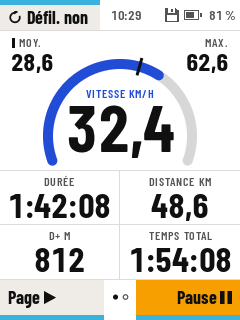 | 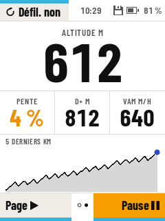 | 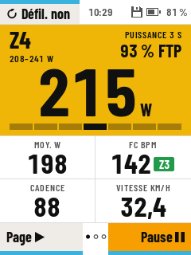 | 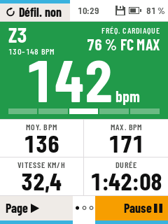 | 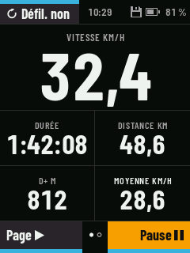 |

- **Barometric altitude and D+**: the barometer's bias calibrated on the GNSS with a Kalman filter, D+ from the
  pressure only (pressure spikes rejected), gradient over the last 40 m, climbing speed, the last 5 km profile
  ([ALTITUDE.md](ALTITUDE.md)).
- **Effort**: 3 s power in the colour of its zone (FTP and zones set from the app), ride averages, heart rate with
  its zone, cadence; with a heart rate sensor only, the same page for the heart rate.

## Route, map and climbs

A GPX route sent from Musette over BLE (or over USB), the climbs found by the app when it builds the route.

| Map, around the rider | Whole route | Off route | Climbs | In a climb |
|:-:|:-:|:-:|:-:|:-:|
| 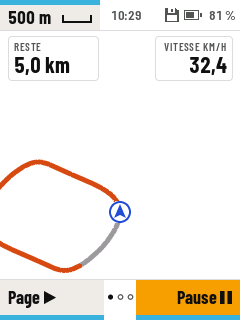 | 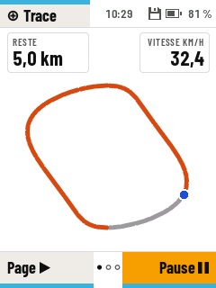 | 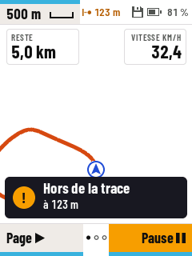 | 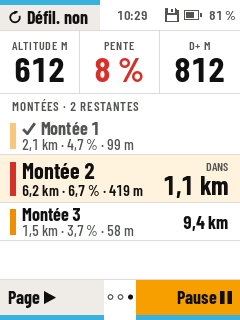 | 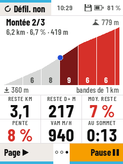 |

- **Map page** turned to the heading, the part done in grey, zooms 250 m to the whole route, remaining distance;
  drawn in 28–47 ms on the device.
- **Off-route alert** beyond 50 m, with the distance to the route.
- **Climbs**: the last one done, the next ones with their distance; in a climb, distance, D+ and time left to the
  top, its profile coloured by gradient with the rider on it.
- **Free ride**: set the route aside from the menu, even mid-ride, without deleting it.

## Sensors

| Sensors | Search | Power meter calibration |
|:-:|:-:|:-:|
| 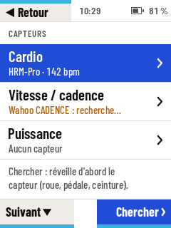 | 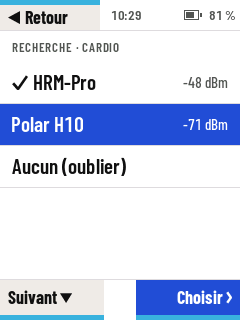 | 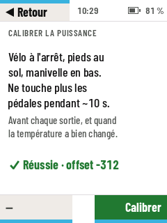 |

- **BLE** heart rate, speed / cadence and power, searched and paired from the device.
- **ANT+** through the nRF co-processor (written, tested on the PC; still to try with a real sensor).
- Power meter zero offset calibration. A sensor lost mid-ride keeps its place with "--" and a banner.

## Recording you can trust

| Home | Pause menu | Ride saved | Rides on the device |
|:-:|:-:|:-:|:-:|
| 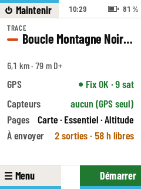 | 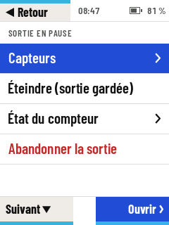 | 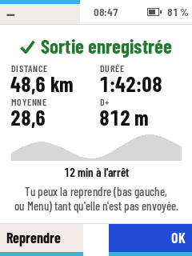 | 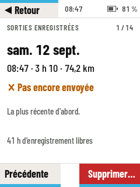 |

- **FIT files that survive a power cut**: appended every 10 s, an interrupted ride closed and offered again at the
  next power-on; tested by cutting the power at every flash operation of a ride (PC) and by random resets on the
  device. Files checked with the Garmin FIT SDK.
- A ride paused at power-off, or the last finished one, can be resumed; a ride started by mistake is erased.
- **Automatic power off** after a while without moving, announced a minute before, the ride kept to resume.
- Storage full handled: rides first, logs give way, a point every 5 s when nearly full.
- **GPS time written back to the RTC**, time zone as a POSIX rule with summer time.
- Charging screen, battery and storage status always in the top bar.

## Companion app (Musette, over BLE)

Settings, routes (with their climbs) sent to the device, rides listed, downloaded and acknowledged. The file
formats and the protocol are shared crates in the MIT [musette](https://github.com/enavarro222/musette)
repository.
