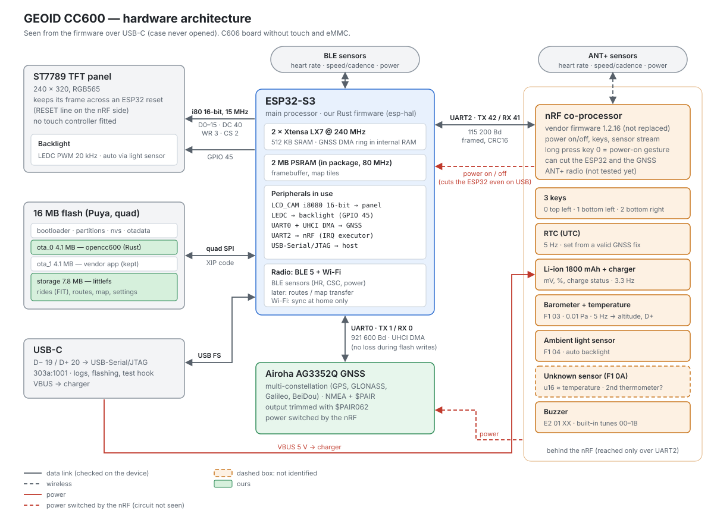

# opencc600 — product definition and plan

Hardware and reverse engineering background: [REVERSE_NOTES.md](REVERSE_NOTES.md).

## Decisions

### 2026-10-20: no action without feedback (rule)
- **Every action gets a visible answer, at once.** A key press changes the screen, shows a banner, or says why
  nothing happens. Anything that takes longer than a moment (saving a ride, a search, a transfer, a power off)
  **says what is going on while it runs** ("Enregistrement…", a progress, a spinner) and then how it ended; the
  rider must never wonder whether the device hung. Keys that do nothing meanwhile are hidden, and presses made
  then are dropped, not acted on later. Applies to every new screen and command; checked in review.
  First case: the end of a ride was silent for a few seconds after "Terminer" (fixed: "Enregistrement…").

### 2026-10-19, evening (replaces the morning's software stack)
- **Language and stack**: **Rust, `no_std`**, on [`esp-hal`](https://github.com/esp-rs/esp-hal) + Embassy (async).
  No ESP-IDF, no LVGL. The `no_std` core compiles unchanged on a PC, which is what makes most of the testing
  automatic (see [DEV_PROCESS.md](DEV_PROCESS.md)).
- **c606-oss is rewritten, not reused**: it becomes the **reference** for a Rust hardware layer (ST7789 i80 init,
  nRF UART protocol, GNSS commands, FIT writer), together with its `docs/HARDWARE.md`. Both projects are
  GPL-3.0, credits kept.
- **Radio stays in Rust**: BLE with `esp-radio` + `trouble-host`, Wi-Fi with `esp-radio` + `embassy-net`.
  The radio blobs are Espressif's whatever the language; the risk is kept behind traits so a brick can be
  swapped. ANT+ stays on the nRF and is driven over the UART link.
- **Testing**: as automatic as possible, **including on the real hardware**, not only on a PC.
  See [DEV_PROCESS.md](DEV_PROCESS.md).

### 2026-10-19, morning (still valid)
- c606-oss is a **hardware reference**, not the application: its UI/app is not what we want.
- **License**: GPL-3.0-or-later.
- **Hardware target**: CC600 = Magene C606 board **without eMMC and without touch** (pinout checked over JTAG).

## What we port from c606-oss
| Block | c606-oss reference | Status on the CC600 (C) | Rust target |
|---|---|---|---|
| ST7789 panel, 16-bit i80 bus, backlight | `main/lcd.c`, `main/backlight.c`, `main/board_c606.h`, `main/board.h` | OK | `cc600-board` (esp-hal LCD_CAM i8080 + LEDC) + `embedded-graphics` |
| nRF link (UART2, CRC16 frames, handshake, keys, battery, temperature/pressure, RTC) | `main/nrf_link.c` | OK | `nrf-link`: pure protocol (`no_std`, host tested) + UART glue |
| ANT+ sensors via the nRF | `main/ant.c`, `main/sensor_list.c` | search answered (no sensor to try yet) | `nrf-link` (ANT+ messages), `sensors::ant` |
| Airoha AG3352Q GNSS (UART0 921600, NMEA, `$PAIR`) | `main/gps.c` | OK, fix in ~6 s, output trimmed (`$PAIR062`) | `gnss`: own NMEA reader + `$PAIR` commands |
| FIT writer | `main/fit.c` | OK, rides recorded on littlefs | `fit` (writer, checked with `fitparser` and the Garmin SDK) + `recorder` |
| UTC / RTC handling | `main/utc.c` | RTC set from the GNSS on a valid fix (to check with a real fix) | `nrf-link` (`RtcTime`), `recorder` (`EpochClock`) |
| Reference doc | `docs/HARDWARE.md` | — | — |

Not ported: `sdcard.c` / `usb_msc.c` (eMMC), `touch.c`, `ui_port.c` (LVGL), Mapsforge maps (`mapfile.c`, `mapview.c`).

## Hardware constraints

The ESP32-S3 runs our firmware; the nRF co-processor (vendor firmware, not replaced) owns the keys, power, charger,
RTC, barometer, light sensor, buzzer and ANT+, and is reached only over UART2. Details in
[REVERSE_NOTES.md](REVERSE_NOTES.md).
- 240x320 colour panel, **3 keys, no touch** → the whole UX is button driven.
- ESP32-S3, 2 MB quad PSRAM, app ≤ **0x420000 (4.1 MB)** per OTA slot.
- Storage: 7.8 MB littlefs `storage` partition (0x860000), 68 % used by the vendor (24 rides = 4.1 MB, its logs,
  settings, A-GNSS data). **Decided 2026-10-19: we take the whole partition** (option b), after a verified backup
  (`dump/storage.orig.bin`, identical to the device) and the 24 rides extracted as standard FIT
  (`tools/vendor_fit.py`). Going back to the vendor = `tools/flash_ota0.py --restore-vendor --storage
  dump/storage.orig.bin` (rides recorded with our firmware meanwhile stay as FIT files outside, not in the vendor
  history). **Restore checked on the device on 2026-10-19**: the vendor firmware boots with all its rides and
  settings; it only touched its own logs. **Format: littlefs through `littlefs2`** (disk v2.0, the crate pins it),
  our own layout `/rides/<start>.part` while recording, `.fit` once closed (`crates/ride-store`, power-cut tested
  at every flash operation on a RAM fake).
- Room (2026-10-21, `ride_store::room`): the rides first. The logs (`/logs/*.csv`, trip log) take 2 MB at most, in files
  of 512 KB (the oldest deleted), and never write into the last 1 MB (~8 h of ride). A ride short of room deletes the
  logs. Below 1 MB left for the rides, a ride records a point every 5 s instead of every second (~40 h in that last MB;
  "Mémoire presque pleine" said once; the floppy disk of the top bar, grey while a ride records, turns red, and the
  pause screen says why; the distance and the timer stay exact, the ascent, the maximum speed and the averages are
  sampled). A ride does not start with less than 64 KB (~2.5 h at a point every 5 s): the "Mémoire pleine" screen lists
  the rides instead, the ones the app has first then the oldest, to delete one at a time (confirmed, "pas encore
  envoyée" in amber), then offers to start. The same screen is in the menu ("Sorties enregistrées"). A ride the app
  acknowledged (`AckActivity`, not implemented yet) is renamed `/rides/<id>.sent.fit` (`ride_store::mark_sent`): the
  `synced` flag of `ActivityEntry`; resumed, it is `.fit` again. A ride that runs out of room says so in a banner and
  tries again every minute (a full littlefs walks the whole file system, 84 ms measured, at each allocation). Rides are
  never deleted by the device on its own. Wear: a ride appends every 10 s, each append copies its last block (~360
  erases/h, ~750 with the trip log); littlefs spreads them over the free blocks, so with ~100 000 cycles a block the
  flash outlasts the device unless the storage stays nearly full, which the reserve prevents.
- BLE + Wi-Fi on the ESP32; ANT+ through the nRF (its firmware is not replaced).
- 1800 mAh battery: battery life is a requirement (Wi-Fi and backlight are expensive). See [POWER.md](POWER.md).
- The nRF RTC is not written by c606-oss → wrong time before the first GPS fix. We write it from the GNSS time on a
  valid fix (the GNSS time without a fix was ~22 s off).
- Barometric pressure + temperature come **from the nRF over UART2** (no direct sensor access from the ESP32).
  Their resolution and rate set the floor for altitude/D+ quality. See [REVERSE_NOTES.md](REVERSE_NOTES.md).
- **The nRF sensor stream (pressure, light) only starts after a long press of the power key.** After an ESP-only
  reset (crash, watchdog, flashing) it stays off and no known command restarts it → a ride resumed after a crash
  would have no altitude/D+. To find: a command that starts the stream; otherwise detect it, fall back to GNSS
  altitude for that segment and tell the rider.
- **IMU: on the C606 only.** The C606 nRF streams accelerometer / gyro frames (`F1 01` / `F1 02`, parsed by
  `nrf-link`), so a C606 port gets an IMU. The CC600 one never sent any (see [REVERSE_NOTES.md](REVERSE_NOTES.md));
  whether a chip sits on its board is unknown.
- **Buzzer**: present, how it is driven is unknown (nRF command or ESP32 GPIO). See [REVERSE_NOTES.md](REVERSE_NOTES.md).

## Altitude and elevation gain (D+)
The vendor firmware gets D+ right thanks to the barometer; ours must be **at least as good**, it is part of the
core a rider checks after every ride.
- **D+ / D- from pressure only**, never from raw GNSS altitude (GNSS vertical noise of several metres inflates D+ a lot).
  Smoothing + an **hysteresis threshold** (a few metres) before counting a climb or a descent.
- **Displayed altitude = pressure-based altitude whose offset is recalibrated slowly** (GNSS altitude averaged
  over time, or the route's elevation profile / a DEM when a route is loaded). Weather drift (a front can shift
  the barometric altitude by tens of metres) affects the absolute value, much less the D+ of one ride.
- **Temperature compensation**: sudden changes (sun/shade, out of a warm car, start of a ride) distort the
  pressure reading; handle the first minutes and fast temperature swings.
- Also derived from the same filtered altitude: **gradient (%)**, VAM, D+ per lap.
- Recorded in the FIT file: per-record `altitude` (enhanced_altitude) and session/lap `total_ascent` / `total_descent`.
- Pure logic in `crates/altitude` (`no_std`), tested on a PC with synthetic rides. Algorithm, tuning and
  references: [ALTITUDE.md](ALTITUDE.md).

## Product questions
1. **Use case**: outdoor rides, **road and MTB**, for the author or anyone with a CC600.
   Home trainer use comes later, if at all.
2. **What the vendor firmware gets wrong** and justifies the project:
   - no map around the planned route;
   - navigation through the menus is heavy, with too many useless functions.
3. **Core that must never break**: reliable FIT recording (crash, empty battery), display, sensors.
4. **What makes it different**:
   - a **corridor map around the loaded route** (see below);
   - a lean, fast 3-key UX;
   - easy ride sync (see 5).
   Later ideas: long-stop detection (GNSS speed on the CC600; crash detection with the IMU on the C606), fully configurable screens, BLE remotes, structured workouts (big later project: interval sessions programmed in the app, followed on the device), FTMS home trainer control,
   integration with home_trainer_game.
5. **Ride sync**: over **Wi-Fi when back home**, to the phone or a **configurable cloud**
   (Strava, self-hosted server…). Wi-Fi stays off during the ride.
6. **Configuration**: in a **companion app** (web app over Web Bluetooth is the current lead, to be decided).
   The device menu stays minimal: sync, sensors, and what is needed on the road. See "UI rules" below.

### UI rules (from the clickable prototype)
Prototype: https://enavarro222.github.io/opencc600/prototype/ — source in [prototype/](prototype/).
- Every screen shows what each of the 3 keys does, next to the key (top-left key = top-left label, bottom keys =
  bottom bar corners). Labels stay consistent with the front silkscreen: bottom-right = main action (start, pause,
  resume, OK), bottom-left = menu / next, top-left = back / contextual.
- No hidden action. Two long presses only, both labelled: "⏻ Maintenir" on the home screen to switch off (and on),
  and the **key lock**: both bottom keys held together (~1 s) lock the keys during a ride (and unlock them the same
  way). Locked, a small padlock stays in the top bar; any press shows a banner "Verrouillé · maintiens les 2 boutons
  du bas", the keys do nothing else. Alerts and pages still show (auto-scroll keeps going); the lock does not
  survive a power off. The hint for the gesture is shown on the pause screen.
- Irreversible actions go through a confirmation screen that says what will happen; confirming uses a different
  key than the one that opened it.
- Riding: up to 4 pages, picked automatically (see "Data pages"), bottom-left cycles pages. Top-left is contextual: map zoom on the
  map page, auto-scroll on/off elsewhere.
- Top bar: the clock in the middle ("GPS ◌" in its place while searching or lost during a ride), the battery on
  the right, the top key on the left in a fixed 100 px box that leaves the middle free.
- Nothing changes size: fixed-width top key, key bar in 3 fixed columns, fixed-height rows; long text is cut
  with "…" rather than pushing the rest (checked by `tools/check_prototype_layout.py`).
- One banner model, floating above the page and never over the key bar: info (blue, 3 s), attention (amber, while
  true: off route, sensor lost), climb ahead, auto-pause. One at a time, by priority.
- One route on the device, sent from the app at any time (even mid-ride). Rides are uploaded as soon as possible
  (home Wi-Fi or app) and deleted only after the upload is confirmed.
- **Free ride without the loaded route**: no question when starting (most of the time the loaded route is the one
  to follow). The home screen always shows the state: route name and distance, or "Parcours libre". The menu (home,
  and pause menu during a ride) has "Rouler sans trace" / "Suivre la trace": the route pages and off-route alerts go
  away (pages recomposed at once, even mid-ride), the route stays stored and can be followed again. A route sent
  from the app is followed. Started by mistake with the wrong route: the off-route banner (amber) says
  "Pas cette trace ? Pause › Menu"; the device never drops the route on its own. Deleting the route from the
  device is possible too, but as a separate, confirmed action.
- GPS: the home screen shows acquisition (state + progress bar); a ride can start before the fix (distance and
  map start at the fix). While riding, "GPS ◌" appears in the top bar only while searching or lost, with a banner.
- Pause screen: bottom-right resume, bottom-left "Finish…" (then confirmation), top "≡ Menu" (sensors, switch off).
  Switching off while paused keeps the ride; it resumes after power-on.
- A finished ride stays **resumable until it has been uploaded** ("↺ Reprendre" on the end screen, then in the
  menu): finishing only closes the FIT file, resuming reopens the same recording. Once uploaded it cannot be
  resumed (it would duplicate the activity), so "Finish" is not shown as an irreversible action.
- The 3 key labels have the same size and a blue mark (the colour of the physical keys) on the key's side:
  top edge for the top-left key (it sits on the top edge), bottom edge for the bottom keys.

### Data pages: chosen for the rider, not built by the rider
No page editor to start with. The app asks **one question** ("ride to explore" or "train"); the device detects the
rest when a ride starts (sensors seen, route loaded) and picks standard views:
- **Essential**: speed (big), time, distance, D+, HR if present (else average speed).
- **Distances under 1 km are shown in metres** ("850 m", by 10 m), then in km with one decimal ("1,2 km"): the
  ride distance, the remaining distance, the distance to a climb or to the route. The threshold is a constant,
  to tune on real rides.
- **Effort** (a power meter paired; the HR alone is on Essential): 3 s power (big), zone bar, then by priority avg
  power, HR, cadence, speed, time.
- **Map** (route loaded), **Altitude** (altitude, gradient, D+, climbing speed over the last minute, last 5 km), **Climbs** (route with climbs, in place
  of Altitude). Climbs, out of a climb: altitude, gradient and D+ of the ride on top, then the climbs (the last one
  done, the next one with its distance, the following ones). In a climb: distance and D+ left to its top, gradient
  measured, its profile coloured by gradient with the rider on it, the gradients of the next 500 m. The climbs are
  found by the app when the route is built (crate `climbs` of musette) and travel in the route file (OCRT v2); a
  route without climbs (flat, or sent before v2) keeps Altitude.

| Usage | With route | Without route |
|---|---|---|
| Explore | Map · Essential · Climbs or Altitude (+ Effort if power) | Essential · Altitude (+ Effort if power) |
| Train | (Effort ·) Essential · Map · Climbs or Altitude | (Effort ·) Essential · Altitude |

A loaded route always brings the Map (4 pages at most). A sensor missing at start takes no slot (the next field moves up). A sensor lost mid-ride keeps its slot with
"--" plus a banner: the layout never moves during a ride. Customising (swapping a view from the catalogue) stays
possible in the app, never required.

### Features and app settings
| Feature | Default | Notes |
|---|---|---|
| Off-route alert (banner + dashed line to the route + beep) | on, beep configurable | |
| Auto-pause | on, configurable | timer stops when not moving |
| Start reminder ("you are riding, start?") | on, configurable | never starts on its own |
| Page auto-scroll | available, toggled on the device | interval set in the app |
| Night mode at sunset | on, configurable | computed from GPS position |
| Climb tracking (list, alert, live climb page) | on | climbs detected in the app when the route is prepared |
| Turn announcements | **off (later)** | cues precomputed in the app (map matching or course points from the route file) |
| Strava segments | **off (later)** | needs a Strava Live Segments licence + user subscription; starred segments otherwise |
| Laps | **off (later)** | |

### Corridor map around the route
The "no maps" limit only applies to a global map. A map restricted to the loaded route fits the CC600:
- **One route at a time**: loading a new route replaces the previous one (no history), so storage stays bounded.
- **Size**: a ±1–2 km corridor around a 100–150 km route is a few hundred km². Simplified vector data
  (roads, tracks, water, maybe coarse contours) should be in the range of a few hundred KB to 1–2 MB,
  which fits in littlefs next to the vendor FIT files. *(to measure on real routes)*
- **Prepared off the device**: the OSM extract is clipped to the corridor and pre-projected on the phone or
  a server, then sent over **Bluetooth** with the route (Web Bluetooth: about 5–20 KB/s, so a few hundred KB at
  most). The CC600 only draws polylines and filled areas on its 240x320 framebuffer (`embedded-graphics`).
- **Two views, both essential**: the overview of the whole ride on its background, and the few km around the
  rider (the 3 zooms of the map page: 2, 4 and 8 km wide). Nothing in between is needed. Measured on a 42 km test
  route (2026-10-20, ±1 km): 67 KB at full detail (roads, tracks, paths, water, forests; buildings +57 KB), the
  overview level 13 KB.
- **Two levels of detail, in cells**: the detail for the zooms around the rider, the overview simplified for its
  scale (to half a pixel, features under a few pixels and thin layers dropped), each cut in a grid of the route's
  plane (cells of 500 m for the detail, larger for the overview); the device looks up only the cells in view.

### MVP
Status on 2026-10-20 (updated by the bring-up work; altitude is worked on in parallel, see
[ALTITUDE.md](ALTITUDE.md)).

- [x] **Reliable FIT recording** on littlefs, `/rides/<start>.fit`; survives a crash or an empty battery: appends
      every 10 s, interrupted rides closed at the next boot (`crates/fit`, `crates/recorder`; power cut at every
      flash operation of a ride and of its recovery on a PC, resets during a ride on the device, files checked
      with the Garmin FIT SDK). Key 1: start / pause / resume, long press: stop.
- [x] **GPS time written back to the nRF RTC** (valid fix only, at most once a minute, 2 s tolerance). Checked on
      the device on 2026-10-19 with a fix: `rtc shift -300` on the USB test hook moved the RTC 5 min back, the next
      fix set it right again, and the trip log shows rtc − gnss = 0 s over the whole session
      (`dump/log_rtc_shift.txt`).
- [x] **Barometric altitude and D+** (see above and ALTITUDE.md), written to the FIT file (altitude from the filter,
      `absolute_pressure`, D+ from the pressure only) and shown on the ride pages.
- [x] **Data screens driven by the 3 keys** (`crates/ui`, after the prototype, compared with it by
      `tools/prototype_shots.py` and `tools/compare_screens.py`): home (GPS acquisition, pages, rides to upload),
      menu, ride pages Essential and Altitude (gradient, last 5 km), auto-scroll, GPS banners, pause and pause menu,
      finish confirmed, end screen, a ride paused at power-off or interrupted offered again at power-on, the last
      finished ride resumable (no upload yet: always the newest). Not yet: sensors, Wi-Fi sync, auto
      pause, start reminder, beeps; the menus show the device status instead.
- [ ] **Beeps** (once the buzzer is understood): key feedback (can be turned off), alerts — off route, sensor lost,
      low battery, recording started/stopped. Every beep comes with a message on screen.
- [x] **Load a GPX route and display the route line** (no background map yet): `crates/route`, sent over USB by
      `tools/send_route.py` until the app does it, kept in `/route`. Map page turned to the heading, the part done
      in grey, zooms 250 m / 500 m / 1 km on the top key (its scale bar), remaining distance and speed; home
      with the route; off-route banner beyond 50 m. Drawn in 28–47 ms on the device (`bench map`). Tested on the
      device with positions sent over USB (`tools/replay_gpx.py`, `tests/hil/test_route.py`).
- [x] **Switch to a free ride without the route** (route kept, see UI rules): menu and pause menu "Rouler sans
      trace" / "Suivre la trace", the ride's pages recomposed at once, home "Parcours libre", the off-route banner
      alternating with "Pas cette trace ? Pause › Menu"; kept in the settings (`follow_route`), a new route is
      followed. Tested on the device (`tests/hil/test_route.py`). Deleting the route from the device: not yet.
- [x] **Settings kept in flash** (`crates/settings`, `/settings`, one `key=value` line each, written in one
      commit): sound, time zone as a POSIX rule with summer time (default `CET-1CEST,M3.5.0,M10.5.0/3`, used
      for the clock and the FIT `local_timestamp`), theme day / night, backlight, usage (explore / train, for the
      pages), auto-scroll interval. Changed with `set key value` on the USB test hook until the app does it. FIT
      `serial_number` from the MAC address.
- [ ] **GPS fix as early as possible**: the GNSS is powered and configured first thing at boot, before the UI and
      the storage checks, and stays on from the home screen (not only when a ride starts). Hot start: last position
      and time saved in flash at power off and sent to the receiver at boot (`$PAIR` time/position aiding), the RTC
      gives the time. Later: A-GNSS / EPO data pushed by the app or downloaded over home Wi-Fi. Measure the
      time-to-fix cold/warm/hot with `tools/ttff.py`, against the vendor firmware.
- [ ] **Key lock**: both bottom keys held together lock and unlock (see UI rules).
- [ ] **Battery life** ([POWER.md](POWER.md)): battery-run log (`/power/<run>.csv`, one line a minute), clean power
      off at low battery, a reference run against the vendor firmware, then the first levers (automatic backlight
      from the ambient light sensor, CPU sleep, GNSS settings).
- [x] **Automatic power off during a ride**: after a while without moving (delay set in the app), the device
      pauses the ride if needed and switches off on its own, keeping the ride to resume after power-on. Going
      through the menu to switch off mid-ride is not good enough. A banner warns before it happens, any key
      cancels it. Done: `auto_off_min` (20 by default, 0 never); still = no GNSS speed, wheel speed, cadence or
      power (no fix counts as still: a café indoors); announced a minute before (half the delay when shorter); a
      key only cancels. Tested on the device (`tests/hil/test_auto_off.py`).
- [ ] **Sensors over BLE and ANT+**: heart rate, cadence, power (the FIT record already has the fields). BLE done
      (`crates/sensors`, `firmware/src/ble.rs`, menu "Capteurs", tested against a fake sensor on the PC:
      `tools/fake_sensor.py`, `tests/hil/test_ble_sensors.py`). ANT+ through the nRF written (`sensors::ant`,
      `firmware/src/ant.rs`, same menu, `ant:TYPE:NUMBER:TRANS` settings), tested on the PC; on the device only
      without a sensor (`tests/hil/test_ant_sensors.py`): to try with a real one.
- [ ] **Open questions understood** (list below): each one explained, or its impact known and accepted.

After the MVP: upload FIT files over Wi-Fi to a configurable URL, then the corridor background map.

### Open questions (to understand for the MVP)
Each one: what we know, why it matters, how to find out. Details in [REVERSE_NOTES.md](REVERSE_NOTES.md).

1. **Airoha outputs not turned off by `$PAIR062`**: `$PAIRSAT` (4/s, ~300 chars, ~1.2 KB/s, most of the remaining
   GNSS traffic), `GNACCURACY`, `GNEPE`, `PLSV`, `PAIRDGP`. Matters for power (UART + DMA + CPU for nothing) and
   for the GNSS receiver's own work. How: the full Airoha PAIR command guide (RYS352x / AG3335 manuals), the
   `$PAIR` strings the vendor firmware sends (`866`, `867`, `490`, `491`, `470`, `382`, `590`, `020`, `023`: try
   each, compare the output), maybe a Magene-specific receiver configuration.
2. **USB serial link loses lines** (~5–7 % of the host → device commands, and log lines) when the log is busy,
   around the nRF task's log bursts. Worked around for the tests (numbered commands, acks, resends, fewer log
   lines), root cause unknown. Matters for the HIL tests and for any future USB sync. How: minimal firmware that
   only echoes and logs, esp-println's USB-Serial/JTAG writer (timeouts, drops when the host is slow) vs the
   esp-hal driver, then an upstream issue.
3. **Ambient light tags 2000 / 3000**: the nRF cycles three measurements; tag 600 is the visible light (411 covered,
   ~2500 indoors by day, ~2600 under a torch: saturates?), 2000 and 3000 stay at 0–6 whatever the light. Matters
   for the automatic backlight (range, saturation in sunlight). How: an infrared remote pointed at the sensor,
   direct sunlight, darkness; the sensor part number (board photo, vendor strings `LightLux`).
4. **nRF stream `F1 0A`** (3.3 Hz, tracks the barometer temperature): meaning unknown. How: heat / cool the device,
   compare with the baro temperature and the battery temperature, vendor factory test strings.
5. **A key click seen twice?** In the first ride recorded by hand, a pause and a resume arrived in the same second,
   3 s after the start. Double press by the rider, or the nRF sending `Click` twice? Matters for a 3-key UX (a
   bounce would pause the ride). How: log the raw key frames during a series of single clicks.
6. **GNSS power path**: `gps_power(1)` restarts a running receiver (it loses its setup), so it is only sent after
   3 s of silence; the silent-receiver case seen once after a power cycle is not tested yet. How: power cycle the
   device with the battery, and send `gps_power(0)` then check the recovery.
7. **GNSS time without a fix ~22 s off**: GPS − UTC leap seconds (18 s) not applied yet, plus drift? Not used, but
   it tells when the receiver's time becomes trustworthy, which could allow an earlier RTC sync. How: watch the
   offset from a cold start until the first fix.
8. **Is the 5 s power-on command to the nRF needed?** The vendor and c606-oss repeat it; no watchdog seen so far.
   Matters for power and log noise. How: stop sending it for an hour and watch the nRF.
9. **Panel readable in sunlight with the backlight off?** (transflective or not) Sets the backlight strategy in
   POWER.md. How: outside, backlight at 0.

### Deliberately out of scope
- global maps (Mapsforge style) and on-device routing / turn-by-turn recalculation
- …

## Technical plan
0. **Bring-up spike, first risk to clear**: an `esp-hal` image written to `ota_0` boots under the **vendor
   second-stage bootloader and partition table** (both left untouched), with the 2 MB quad PSRAM.
   Done when: backlight on + log line on the USB serial.
   **Done 2026-10-19** (`firmware/`, esp-hal 1.2.2 + esp-rtos 0.4): the vendor bootloader loads the 101 KB image
   from 0x20000, PSRAM comes up in quad mode (2 MB, set explicitly: `PsramMode::Auto` probes octal first),
   LEDC backlight on GPIO45, `log` output over the USB-Serial/JTAG. The vendor bootloader prints its own log
   (partition table, segments) on the same port. Flashed with `tools/flash_ota0.py`.
1. Toolchain: Rust Xtensa fork via `espup` (ESP32-S3 is Xtensa), `espflash` to build the image,
   `esptool` to write `ota_0` (see the workflow below). Pinned in `rust-toolchain.toml`.
2. Cargo workspace:

   | Crate | `no_std` | Content |
   |---|---|---|
   | `core` | yes | ride logic, screens state machine, sensors model, altitude/D+ filter, UTC/RTC, sync protocol; no hardware dependency |
   | `ui` | yes | screens drawn with `embedded-graphics` |
   | `fit` | yes | FIT writer *(exists)* |
   | `recorder` | yes | ride recording on `ride-store`, totals, recovery after a power cut *(exists)* |
   | `nrf-link` | yes | nRF frames, CRC16, handshake, keys, battery, pressure/temperature, RTC, ANT+ |
   | `gnss` | yes | NMEA parsing, `$PAIR` commands |
   | `cc600-board` | yes | esp-hal wiring: i80 panel, UARTs, backlight, flash, radio |
   | `firmware` | yes | the binary flashed to `ota_0` |
   | `sim` | no (PC) | SDL simulator, headless renderer, scenario player, fakes |

   Drivers and core only see traits (`embedded-hal`, `embedded-io-async`, `embedded-storage` and our own
   `SensorSource`, `SyncTransport`, …), so everything above `cc600-board` runs on a PC.
3. Bring-up order on the device: panel *(done 2026-10-19: `firmware/src/panel.rs`, framebuffer in PSRAM
   flushed in 40-line DMA bands)* → nRF link *(keys, battery, RTC read, barometer, light sensor, buzzer, power off, RTC write done
   2026-10-19: `crates/nrf-link`; RTC set from the GNSS on a valid fix: done, to check with a real fix)* → storage
   *(done 2026-10-19: our littlefs on the whole partition, `crates/ride-store`, power-cut tested on a PC at every
   flash operation and on the device with random resets)* → GNSS *(done 2026-10-19: `crates/gnss`, UART DMA robust
   to flash writes, output trimmed with `$PAIR062`, powered by the nRF only when silent; constellation choice: after
   the power measurements)* → FIT recording *(done 2026-10-19: `crates/fit`, `crates/recorder`, HIL tests in
   `tests/hil`)* → data screens and settings → BLE / ANT+ sensors → Wi-Fi sync.
4. Then sync / configuration / differentiating features, following the MVP.

### Planned dependencies
- Base: `esp-hal`, `esp-rtos`, `esp-alloc`, `esp-storage`, `esp-backtrace`, `embassy-executor` / `-time` / `-sync`, `defmt`
- Radio: `esp-radio`, `trouble-host` (BLE host), `embassy-net` + `reqwless` (HTTP) + `embedded-tls` or `esp-mbedtls`
- Display: `embedded-graphics`, `embedded-graphics-simulator` (PC)
- Data: `nmea`, `littlefs2` (or `sequential-storage` / `ekv`, see storage above)
- Update: an OTA path with a safe fallback (`embassy-boot` or ESP-IDF style OTA slots) — needed as soon as
  other people install the firmware
- Tests: `proptest`, `insta`, `embedded-hal-mock`, `embedded-test`

### Open technical choices
- UI: `embedded-graphics` + our own small widgets (lean) vs Slint (full framework, heavier on RAM).
- ~~Storage~~: decided, littlefs (`littlefs2`) on the whole partition, see "Hardware constraints".
- Status of `esp-radio` BLE (central role, GATT client) to check early with a heart-rate strap and a power meter.

## Flash and rollback workflow (checked on 2026-10-19)
- Build: `cargo build --release`, then `espflash save-image --chip esp32s3 --flash-size 16mb` to get an app image
  for `ota_0` (checked in step 0). The c606-oss Docker build in REVERSE_NOTES.md stays useful to run the reference firmware.
- Flash: only `ota_0` (0x20000), then erase `otadata` (c606-oss `tools/flash_poc.py` does this and backs up first;
  `tools/flash_ota0.py` does the same and refuses any other offset).
- **Back to the vendor firmware**: write the original otadata back,
  `esptool -p /dev/ttyACM0 write-flash 0xd000 otadata.bin` → boots `ota_1` (V1.407).
- Keep a full 16 MB flash dump of the device before the first write.
- Recovery: holding the 3 keys hard-resets the ESP32; the ROM download mode is reachable over USB at any time.
- Tools: `esptool` (e.g. `uv tool install esptool`), OpenOCD Espressif build (`openocd-esp32` release,
  linux-amd64) with its `60-openocd.rules` udev rule, `tools/read_pins.py` for the live pinout.
- **Never** write eFuses, the bootloader (0x0) or the partition table (0x8000).
