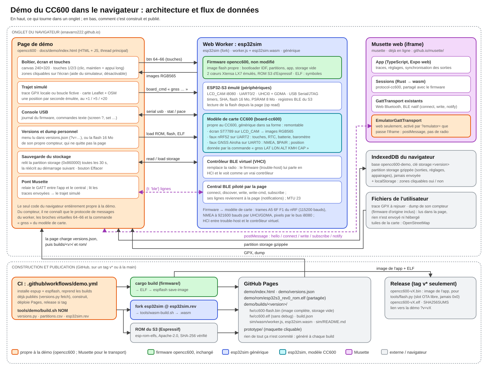

# The firmware in the browser

[index.html](index.html) runs the opencc600 firmware, unmodified, on an emulated CC600:
**https://enavarro222.github.io/opencc600/demo/** (the page is in French). The screen, the three keys and the USB
console work as on the device. A simulated nRF52 provides the clock, the battery and the barometer, a simulated GNSS
receiver follows a GPX track played on a map, and BLE goes through the emulator's virtual controller. Nothing leaves
the page.

The emulator is [esp32sim](https://github.com/mikroverk/esp32sim) compiled to WebAssembly, from the fork
[enavarro222/esp32sim](https://github.com/enavarro222/esp32sim) that adds the CC600 board, at the commit in
[tools/demo/esp32sim.rev](../../tools/demo/esp32sim.rev).



Dashed in the diagram: planned, not written yet (Musette next to the device, see below).

## Where the code lives

| What | Where | Specific to the demo? |
|---|---|---|
| The page: case, keys and clickable screen hints, simulated ride, USB console, version menu, visitor's own dump, saved storage | `docs/demo/index.html` | yes |
| Build and publication | `.github/workflows/demo.yml`, `tools/demo/` (`build.sh`, `versions.py`, `partitions.csv`, `esp32sim.rev`) | yes |
| The firmware | `firmware/` | no: the same ELF as on the device |
| The emulated ESP32-S3, the worker and its message protocol, the virtual BLE controller, the flash read-back | esp32sim fork, generic branches | no: meant to go upstream |
| The CC600 board model: ST7789 panel, nRF52 on UART2, Airoha GNSS on UART0 | esp32sim fork, branch `board-cc600` | CC600-specific, written like esp32sim's other boards |
| Musette's emulator transport (planned) | musette, a `GattTransport` next to Web Bluetooth | yes |

The page knows only three things about the device: the worker's message protocol, the virtual pins 64–66 the
board model maps to the keys, and the board's `gnss LAT LON ALT KMH COURSE` command. Everything else is the
firmware talking to emulated hardware.

## Data flow

- **Keys**: a click or a hold (½ s: long press) on a key, on its clickable hint on the screen, or on keys 1, 2, 3 →
  `{t: 'btn', pin: 64..66}` → the board's nRF model → a key frame on UART2, as the real nRF sends it.
- **Screen**: the firmware draws through LCD_CAM's i8080 bus → the board's ST7789 model → RGB565 frames → the canvas.
- **Ride**: the page samples the track once per emulated second → `{t: 'board_cmd', line: 'gnss …'}` → the GNSS model
  sends GGA/RMC at 921600 baud, read by the firmware through UHCI and GDMA. The barometer follows the altitude.
- **USB console**: the firmware's log and the commands typed in the page (`screen ?`, `set …`).
- **Storage**: every 30 s, when the page goes to the background and before a restart, the page reads the `storage`
  partition back (`{op: 'read'}`), gzips it into IndexedDB (database `opencc600-demo`, one entry per version) and
  writes it over the clean image at the next boot. Rides, settings and pairings survive a reload; *Effacer* starts
  over.

## Versions and the visitor's own firmware

`versions.json` lists the published builds, `main` first. Each one is self-contained in `builds/<name>/`: its flash
image, its ELF and its emulator. The menu choice is kept in the URL (`?v=v0.1.0`).

A visitor can also load the full 16 MB flash dump of their own device (`esptool read-flash 0 ALL dump.bin`), vendor
firmware included: it runs with the emulator of the selected version, stays in their browser and is not saved. The
vendor firmware is not distributed here.

## Build and run locally

```sh
tools/demo/build.sh main                     # -> docs/demo/builds/main/, docs/demo/rom/, docs/demo/versions.json
python3 -m http.server -d docs 8795          # http://127.0.0.1:8795/demo/
```

`build.sh` builds the firmware (the `esp` toolchain from `espup`, as in [DEVELOPMENT.md](../DEVELOPMENT.md)) and makes a
clean flash image: espflash's IDF bootloader, [partitions.csv](../../tools/demo/partitions.csv), our app and a blank
storage partition, nothing from a device. It clones the esp32sim fork at `esp32sim.rev` into `target/demo/esp32sim`
and builds the emulator; `ESP32SIM=<checkout>` uses a local one instead. The generated files are not committed.

Natively, with the same files:
`esp32sim --board cc600 --boot rom --rom docs/demo/rom/esp32s3_rev0_rom.elf --flash-image
docs/demo/builds/main/fw/cc600-flash.bin --elf docs/demo/builds/main/fw/cc600.elf --flash-mb 16 --psram-mb 8 --ble
--web 8642`.

## Publication and releases

The [demo workflow](../../.github/workflows/demo.yml) runs on a `v*` tag or by hand from the Actions tab (a build named
`main` by default), not on every push. It builds, fetches the builds already published so that a deployment keeps
them (`versions.py fetch`), and deploys the demo and the [prototype](../prototype/) on GitHub Pages.

A tag also gets a GitHub release: `opencc600-<tag>.bin`, the application image for
[tools/flash.py](../../tools/flash.py) (the free OTA slot, never 0x0), the ELF and their SHA-256.

GitHub settings, once: Pages → source *GitHub Actions*; Environments → `github-pages` → allow the tags `v*`.

## Planned: Musette next to the device

[Musette](https://github.com/enavarro222/musette)'s web version already reaches the device through a small
`GattTransport` interface (connect, subscribe, write, notify). An emulator transport, a central in esp32sim driven by
the page (it exists for scripts), and the page relaying between the two would let the app sync routes, settings and
rides with the emulated device, side by side: both pages are on `enavarro222.github.io`.

## Limits

- The emulator runs the firmware at about real time on a recent computer; the first boot takes a few seconds.
- The emulated BLE link uses a 23-byte MTU.
- The nRF and GNSS models cover what the open and the vendor firmware use, not the whole of those chips.
