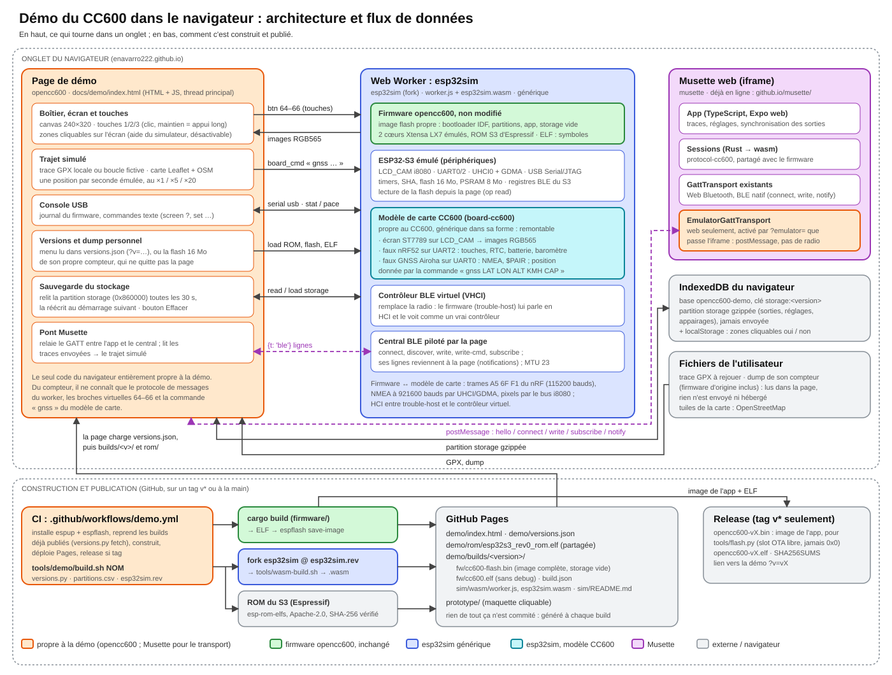

# The firmware in the browser

[The main page](../site/index.html) runs the opencc600 firmware, unmodified, on an emulated CC600:
**https://enavarro222.github.io/opencc600/** (the page is in French). The screen, the three keys and the USB
console work as on the device. A simulated nRF52 provides the clock, the battery and the barometer, a simulated GNSS
receiver follows a GPX track played on a map, and BLE goes through the emulator's virtual controller. Nothing leaves
the page.

The emulator is [esp32sim](https://github.com/mikroverk/esp32sim) compiled to WebAssembly, from the fork
[enavarro222/esp32sim](https://github.com/enavarro222/esp32sim) that adds the CC600 board, at the commit in
[tools/demo/esp32sim.rev](../../tools/demo/esp32sim.rev).



## Where the code lives

| What | Where | Specific to the demo? |
|---|---|---|
| The page: case, keys and clickable screen hints, simulated ride, USB console, version menu, visitor's own dump, saved storage, the bridge to Musette | `docs/site/index.html` | yes |
| Guided visits: instructions, highlighted controls and validation of the firmware's responses | `docs/site/tours.mjs` | yes |
| Build and publication | `.github/workflows/demo.yml`, `tools/demo/` (`build.sh`, `versions.py`, `partitions.csv`, `esp32sim.rev`) | yes |
| The firmware | `firmware/` | no: the same ELF as on the device |
| The emulated ESP32-S3, the worker and its message protocol, the virtual BLE controller, the flash read-back | esp32sim fork, generic branches | no: written so they could go upstream |
| The CC600 board model: ST7789 panel, nRF52 on UART2, Airoha GNSS on UART0, ANT+ sensors | esp32sim fork, branch `board-cc600` | CC600-specific, written like esp32sim's other boards; may stay in the fork |
| Musette's emulator transport | musette, `app/src/lib/transport/emulator.ts`, web only | yes |

The page knows only three things about the device: the worker's message protocol, the virtual pins 64–66 the
board model maps to the keys, and the board's `gnss LAT LON ALT KMH COURSE` command. Everything else is the
firmware talking to emulated hardware.

## Guided visits and browser tests

Three visits are offered before starting the device: **Enregistrer une sortie**, **Connecter une ceinture cardio**
and **Éteindre et recharger**. Instructions highlight a control, and the visit advances automatically after the expected
response, once any held key has been released. The visitor can use the real controls or **Faire cette étape pour moi**, which dispatches the same key
presses and clicks. The firmware is not replaced with scripted screens or injected UI state.

The counter keeps the central column before and after boot. Suggestions appear progressively as quiet side
cards; the guide occupies the left side during a visit. A curved SVG arrow follows the actual target on scroll
and resize, without intercepting clicks. Playback and sensor controls are temporarily moved beside the counter
(above it on phones), using the same DOM elements and handlers, then returned to their original panels.
Reduced-motion preferences disable the entrance animation.

`tours.mjs` contains the shared scenarios and their checks. During a visit the page asks the existing, read-only
USB command `screen ?` for the current screen. Recording and pairing steps additionally require new firmware log
events (including the successful FIT save), so an earlier pause or an unconfirmed button press cannot validate a
later step. GPS playback and the simulated sensor's switch are checked on the simulation controls; subsequent
recording, discovery and pairing are confirmed by the firmware. This exercises the running firmware and emulator,
without claiming coverage of the physical radio or hardware.

Before entering, the page finishes saving free exploration. It boots a clean flash for the visit, bypasses the
saved partition, and disables automatic saves until leaving. Exiting, finishing or reloading restores the free
partition; the visit's rides and pairings are temporary. Simulation controls are restored on exit. A personal flash
dump and older emulator builds lacking a required feature are rejected with a way back to free exploration.

```sh
make test-demo                                # Node.js tests: observations, validation, BLE bridge and sensors
uv run --with playwright==1.55.0 playwright install chromium  # once, unless Google Chrome is available
make test-demo-e2e NAME=local                  # stage the existing build, serve it, replay all visits
# Or use a demo already being served:
uv run --with playwright==1.55.0 python3 tools/demo/check_tours.py 'http://127.0.0.1:8765/?v=local'
```

The browser runner reads the step and completion state from the visible guide, clicks its actions, checks automatic progression, and checks
the firmware evidence. It never supplies success to the guide. Logs, screenshots and the visited steps are saved
under `target/demo/tour-check/`; failures retain the full page and USB log. The tests workflow runs the fast page
tests and replays these same visits after building the simulator firmware, uploading the reports as an artifact.

## Data flow

- **Keys**: a click or a hold (½ s: long press) on a key, on its clickable hint on the screen, or on keys 1, 2, 3 →
  `{t: 'btn', pin: 64..66}` → the board's nRF model → a key frame on UART2, as the real nRF sends it.
- **Screen**: the firmware draws through LCD_CAM's i8080 bus → the board's ST7789 model → RGB565 frames → the canvas.
- **Ride**: the page samples the track once per emulated second → `{t: 'board_cmd', line: 'gnss …'}` → the GNSS model
  sends GGA/RMC at 921600 baud, read by the firmware through UHCI and GDMA. The barometer follows the altitude.
- **A route sent from Musette**: the page also reads the frames Musette writes (musette's `protocol-cc600`:
  `TransferBegin` of a route, `TransferChunk`s, `TransferEnd`), decodes the `OCRT` file (`route-cc600`: a local
  plane in decimetres, zigzag varint deltas) back to latitudes and longitudes and loads it as the simulated ride:
  the GPS follows the route the device now guides along. Neither the app nor the firmware knows.
- **USB console**: the firmware's log and the commands typed in the page (`screen ?`, `set …`).
- **Storage**: every 30 s, when the page goes to the background and before a restart, the page reads the `storage`
  partition back (`{op: 'read'}`), gzips it into IndexedDB (database `opencc600-demo`, one entry per version) and
  writes it over the clean image at the next boot. Rides, settings and pairings survive a reload; *Effacer* starts
  over.

## Versions and the visitor's own firmware

`versions.json` lists the published builds, `main` first. Each one is self-contained in `builds/<name>/`: its flash
image, its ELF and its emulator. The menu choice is kept in the URL (`?v=v0.1.0`).

A visitor can also load the full 16 MB flash dump of their own device (`esptool read-flash 0 ALL dump.bin`), vendor
firmware included: it runs with the emulator of the selected version, stays in their browser and is not saved. The
vendor firmware is not distributed here.

## Simulated external sensors

The **Capteurs** tab under **Environnement de sortie** exposes an ANT+ heart-rate strap (6001), a combined speed /
cadence sensor (6002), and a power meter (6003). They start disabled. Enable them, then search and pair them from
the device's normal sensors menu. Musette keeps its independent BLE connection.

Each measurement has its own source: a fixed value, the current GPX/FIT record, or a simple model following the
GPS's speed and gradient. GPX extensions `hr`, `cad`, `power`/`watts` and `speed` are read; FIT record fields,
enhanced speed/altitude, compressed timestamps and big-endian definitions are supported; developer-field payloads are skipped.
FIT CRCs and message boundaries are checked. FIT files need at least two GPS positions; sensor records between
positions still contribute their measurements. Files remain in the browser.

Recorded measurements hold until the next record, for at most ten trace seconds. Missing values remain missing;
speed is calculated from positions when no speed was recorded. Speed and cadence have separate sources but share
one radio device: if either measurement is missing, this device sends no data pages. Fixed and recorded values
continue to broadcast while playback is paused. The model instead follows the stopped GPS, with zero power and
cadence and gradual heart-rate recovery. It estimates rolling, gravitational and aerodynamic effort for an 85 kg
rider/bicycle; it is intended to exercise the device, not to predict a real rider's performance.

Values displayed in the tab are the measurements broadcast every emulated second, whether the tab is visible or
not. **Simuler une coupure** stops discovery and measurements, so the firmware's own link/data timeouts apply;
**Rétablir le capteur** resumes transmission with the same identity. Wheel/crank counters use emulated time and
continue across source changes; no firmware readings or pairing settings are injected by the page.

The sensors are part of the CC600 board model in the esp32sim fork (`board ant ...`). `features: ["ant-sensors"]` in the
build metadata enables the panel for that build; older published builds remain usable and show that external sensors
are unavailable.

After staging and serving a build, `tools/demo/check_sensor_search.py http://127.0.0.1:8765/?v=local` exercises
discovery and pairing of all three sensors using the counter's buttons. Build identifiers on the worker, WASM
and firmware URLs prevent a browser from combining a newly rebuilt page with an older emulator. Rebuild the
selected version (`NAME=local`, for example) when testing the sensors locally.

## Build and run locally

```sh
make demo NAME=main                           # -> docs/demo/builds/main/, docs/demo/rom/, docs/demo/versions.json
make preview NAME=main                        # build and serve the complete site locally
```

`build.sh` builds the firmware (the `esp` toolchain from `espup`, as in [DEVELOPMENT.md](../DEVELOPMENT.md)) and makes a
clean flash image: espflash's IDF bootloader, [partitions.csv](../../tools/demo/partitions.csv), our app and a blank
storage partition, nothing from a device. The emulator is the fork's release named by `esp32sim.rev`, fetched and
checked; `ESP32SIM=<checkout>` builds a local one instead. The generated files are not committed.

Natively, with the same files:
`esp32sim --board cc600 --boot rom --rom docs/demo/rom/esp32s3_rev0_rom.elf --flash-image
docs/demo/builds/main/fw/cc600-flash.bin --elf docs/demo/builds/main/fw/cc600.elf --flash-mb 16 --psram-mb 8 --ble
--web 8642`.

## Publication and releases

The [site workflow](../../.github/workflows/demo.yml) runs on a `v*` tag or by hand from the Actions tab (a build named
`main` by default), not on every push. It fetches the builds already published so that a deployment keeps them
(`versions.py fetch`), then calls the same Makefile targets used locally to build and stage the page. The prototype
stays in the repository as an archive and is not published.

A tag also gets a GitHub release: `opencc600-<tag>.bin`, the application image for
[tools/flash.py](../../tools/flash.py) (the free OTA slot, never 0x0), the ELF and their SHA-256.
Before making a release tag, run `make prepare-release VERSION=X.Y.Z` with no modified tracked files and with local
Cargo `[patch]` entries disabled. It updates the Cargo manifest and lockfile versions, then runs `make check`. Review
and commit the changes, then push the matching
`vX.Y.Z` tag. This keeps Cargo's package metadata aligned with the tag used for the version shown on the device. The
command only prepares those files; it does not create the tag or publish the release. The tag workflow checks this
alignment and fails before building or publishing if it is missing. See
[DEVELOPMENT.md](../DEVELOPMENT.md#preparing-a-release) for details.

GitHub settings, once: Pages → source *GitHub Actions*; Environments → `github-pages` → allow the tags `v*`.

## Musette next to the device

*Ouvrir Musette* loads [Musette](https://github.com/enavarro222/musette)'s web version in a phone frame, with
`?emulator=<this page's origin>`. With that parameter, and only in its web build, Musette replaces Web Bluetooth with
`EmulatorGattTransport` (`app/src/lib/transport/emulator.ts`): its GATT operations go to this page by
`postMessage`, to that origin only. The page turns each one into commands of esp32sim's virtual central
(`{t: 'ble', line: 'connect' | 'mtu 247' | 'discover' | 'write H HEX' | 'write-cmd H HEX' | 'subscribe CCC'}`) and
answers when the line it waits for comes back; notifications are relayed to the app. At connection the page asks
for an ATT MTU of 247, as a phone does, and tells the app the MTU it got: writes of up to 244 bytes (an emulator
without the `mtu` command keeps 23, 20 bytes a write). The app then syncs settings, routes and rides with the
emulated device as with a real one.

The CCCD is taken right after its characteristic's value (trouble-host's layout): trouble-host 0.7 answers the
descriptor discovery in a malformed format.

Automatic power off leaves the nRF and its power key running. ANT+ deadlines are suspended while the ESP32 is
off, so external sensors cannot stall the emulated clock or prevent a long press from waking it. The page uses
the emulator's `stat.powered` field to show the off state and reject Bluetooth operations promptly while off.
On a chip reset, the virtual-central bridge discards the old connection, MTU and characteristic handles, then
reconnects and restores Musette's notifications when the device advertises again. The same iframe and app session
remain usable after a power-key or USB wake. An in-progress operation is rejected on power loss.

`tools/demo/check_power_cycle.py http://127.0.0.1:8765/?v=local` tests a real one-minute automatic power off with
a sensor broadcasting, power-key wake, USB wake, and a Musette setting write/read after each wake. The staged
site needs a Musette export for this check. Bridge reset and notification behavior also have isolated tests:
`node tests/demo/gatt.test.mjs`.

`?musette=<url>` loads another Musette, a local build for instance (`npx expo export --platform web` in
`musette/app`, served on another port).
The local `make site-copy` / `make preview` workflow also includes an available
`../musette/app/dist` export and selects it automatically (build it with
`MUSETTE_BASE_URL=/musette`). Each **Recharger** opens a fresh iframe document,
so browser caching cannot keep an old set of app bundles after an update.

## The esp32sim fork

The fork's branches are stacked from the most generic to the most specific: fixes of the emulated S3, then generic
additions (host inputs, the virtual BLE controller for esp-radio, the flash read-back, the page-driven BLE
central), then behaviour inferred from the ROM without a register map, then the CC600 board. Now that the demo and
Musette work together, the plan is to show the project to esp32sim's developers in an issue and ask which of these
they would take as pull requests; the rest stays in the fork.

## Ideas

- **The CC600 board model in this repository.** esp32sim picks its boards from a fixed list; a small, generic
  registration point (a board constructor by name, in the CLI and the browser build) would let `opencc600` own the
  board model in a crate of its own, building its own emulator and WebAssembly at a pinned esp32sim commit. The
  fake nRF and GNSS could then use `crates/nrf-link` and `crates/gnss` instead of a second copy of the protocols, and
  the fork would keep only generic code. Not started.

## Limits

- The emulator runs the firmware at about real time on a recent computer; the first boot takes a few seconds.
- The nRF and GNSS models cover what the open and the vendor firmware use, not the whole of those chips.
